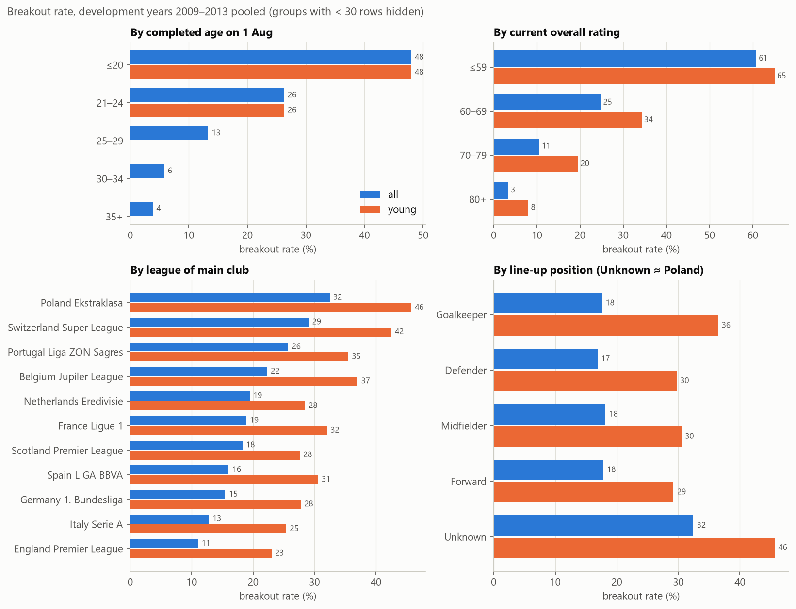
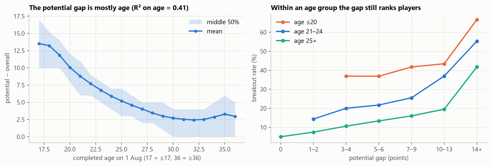

# Check-in 1 (24 Nov) · Cleaned data, plots, correlations, initial features, baseline

What the teacher asked for at this check-in, and where it is:

| Requirement | Where |
|---|---|
| Cleaned data | [data/cleaned_player_years.csv.gz](data/cleaned_player_years.csv.gz) (25,502 rows × 63 columns), [20-row preview](data/cleaned_preview.csv), [cleaning audit](data/cleaning_audit.csv) |
| Plots | [figures/](figures/) (8 figures, made by [02_exploration_features.ipynb](02_exploration_features.ipynb)) |
| Correlations | [Spearman heatmap](figures/04_feature_correlation_heatmap.png), [skill clustermap](figures/05_skill_correlation_clustermap.png), [tables/univariate_association.csv](tables/univariate_association.csv) |
| Initial features | [tables/feature_sets.csv](tables/feature_sets.csv); definitions in [report/02_exploration_features.md](report/02_exploration_features.md) |
| Baseline | [tables/baseline.csv](tables/baseline.csv) (EA potential-gap ranking vs a random watchlist) |
| Write-up | [report/01_problem_data_cleaning.md](report/01_problem_data_cleaning.md), [report/02_exploration_features.md](report/02_exploration_features.md) |

Code: [`src/cleaning.py`](../src/cleaning.py) builds `data/`; [`src/features.py`](../src/features.py) and
[`src/eda.py`](../src/eda.py) power the notebook. Reproduce from the repository root:

```sh
python -m src.cleaning
jupyter nbconvert --to notebook --execute --inplace A_checkin_1124/02_exploration_features.ipynb
```

## Headline

In 2011 a scout could follow 361 of the 3,618 eligible players. Picking the largest gaps between
EA's potential and overall rating found 160 of the 729 eventual breakouts; a random list of the same
size finds about 73. The gap ranking also beat random selection in 2012 and 2013. This is the
baseline our models must beat.

## What one cleaned row means

On 1 August 2011 Mark Davies had started nine matches in the season just finished. His latest overall
rating was 72 and his potential 78 (a six-point gap). His latest rating in the next 12 months was 75.
The median change that year was 0, so his +3 counts as a breakout. The scout knows everything except
the later rating on 1 August; the later rating only grades the prediction.

## Cleaning in brief (details: report/01)

- Ratings: 836 empty records and 21 isolated spikes (entry errors such as 53, 53, 44, 54) removed;
  all ratings within 0–100; no duplicate player-date pairs.
- Matches: no duplicates, no dates outside their season, no missing goals, no unknown teams.
  A home player copied into an away slot (13 matches) is counted once.
- Positions come from formation coordinates: Y 1 goalkeeper, 3 back line, 5–9 midfield, 10–11 attack.
- 29,149 starter-years give 25,502 labelled rows (8,903 players). 11.48% of starters with a current
  rating have no rating a year later and cannot be labelled: they are older, lower rated and mostly
  from smaller leagues ([selection_bias.csv](data/selection_bias.csv)).
- Line-ups are incomplete in 2008/09 and in small leagues; Poland has no coordinates until 2013, which
  explains 801 of the 808 rows without a position. Rows are kept and flagged
  (`club_lineup_coverage`, `league_match_coverage`, `position_missing`).
- `horizon_days` (days between the two ratings, 7–696) is stored for sensitivity checks only.
- Splits: 2009–2010 training only, 2011–2013 rolling validation, 2014 final test (3,629 rows),
  2015 dropped because ratings end on 7 July 2016.

## What the plots show (details: report/02)



- Players aged 20 or younger broke out 48% of the time, against 13% at 25–29. Players rated 60–69
  broke out 25% of the time, against 11% at 70–79.
- Known positions all sit at 17–18%. The 32% for "Unknown" is a Poland effect, not a position effect.
- League rates range from 11% (England) to 32% (Poland).



- EA's potential gap is largely age (age explains 41% of its variance), but within an age group it
  still ranks players. This is why we also test models without potential.
- The 33 skills are highly redundant (24 pairs with |r| > 0.8; 6 principal components explain 80%).

## Baseline on the validation years

| Year | All · EA gap | All · random | Young · EA gap | Young · random |
|---|---:|---:|---:|---:|
| 2011 | 44.3% | 20.1% | 60.7% | 34.1% |
| 2012 | 43.3% | 18.2% | 52.1% | 29.1% |
| 2013 | 36.1% | 11.3% | 50.0% | 20.9% |

Precision@10% is the share of the watchlist (10% of each year's cohort, rounded down) that broke out.
Random precision equals the year's breakout rate.
