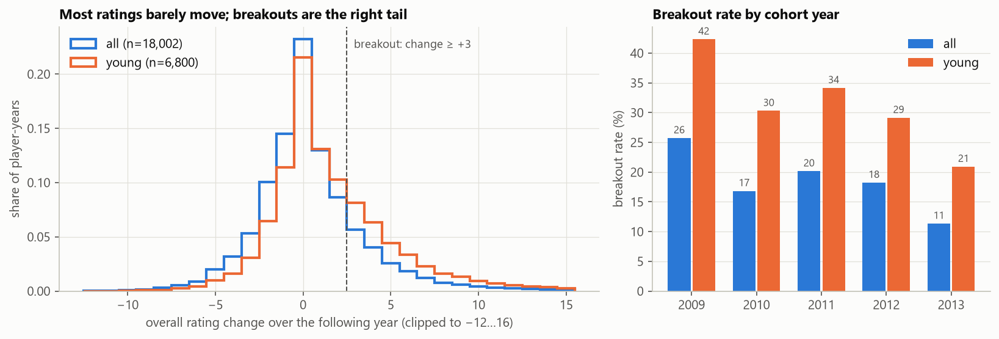
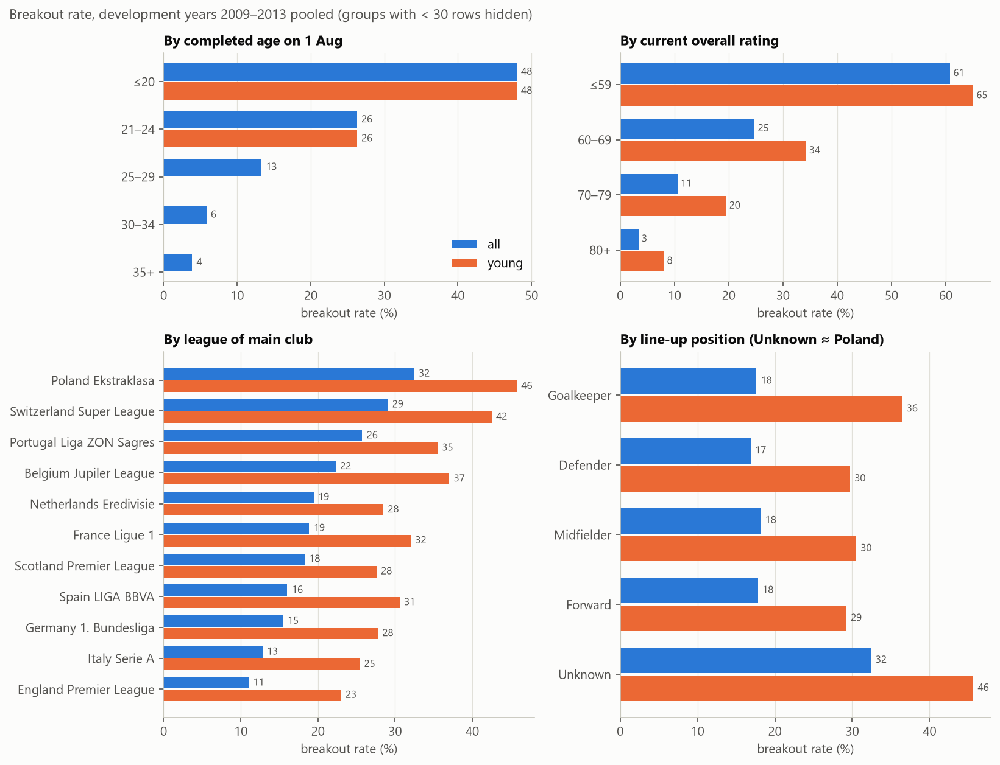
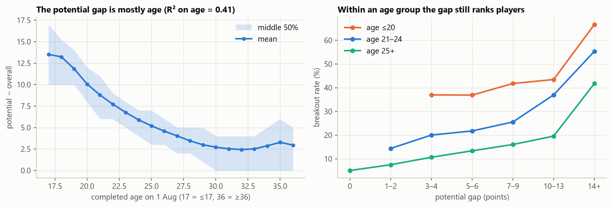
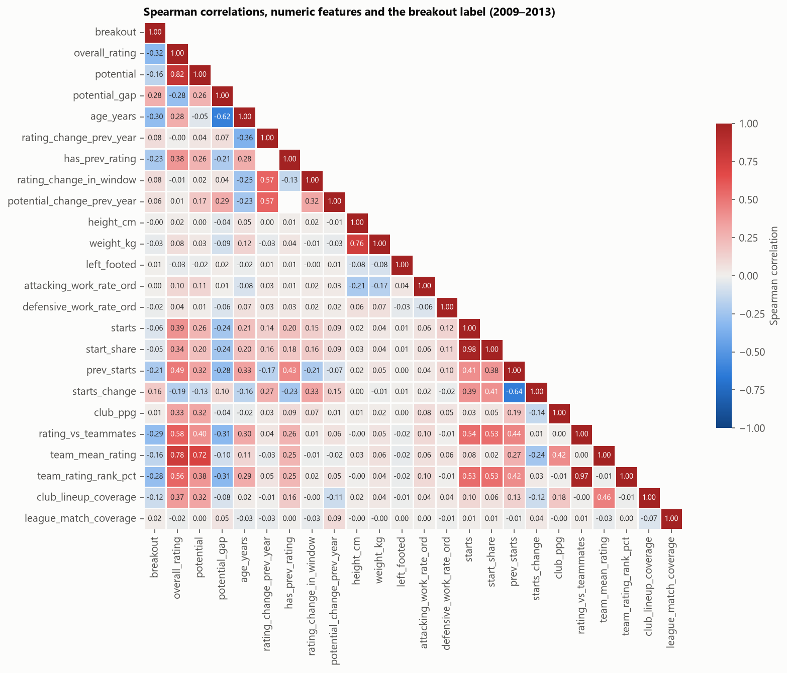

# Predicting Breakout Football Players — Check-in 1

**Team:** Shiyan Wang, Junius, Noah Feng, Xianghe Meng · IDSC-GH 5010 Introduction to Data Science, Fall 2026

This covers what the first check-in asks for: the cleaned data, plots, correlations, first features
and a baseline.

## 1. Problem and data

### The question

A club's scouts cannot watch every player, so they need a short list. We ask: using what is known
on 1 August, can we pick the players whose FIFA overall rating will jump over the next year? We call
such a jump a **breakout**. A player breaks out if his latest rating in the 12 months after 1 August
is at least 3 points higher than his latest rating in the 12 months before, after taking away the
median change of all players that year. The median change is 0 in every year from 2009 to 2014, so in
practice a breakout means a rise of 3 points or more.

The action is simple. Every 1 August the scouts take the top 10% of our ranking and follow those
players. We judge a ranking by **Precision@10%**: the share of the watched players who really break
out. We run everything twice, for all players and for young players (24 or younger on 1 August),
because young players are the ones scouts care about most.

### One data point

One row is one player in one year, for players who started at least one league match in the season
that just ended. For example, on 1 August 2011 Mark Davies had started 9 matches. His latest rating
was 72 and his potential was 78. His latest rating in the next 12 months was 75. The change of +3
equals the median (0) plus 3, so this row is a breakout. Everything except the later rating is known
on 1 August.

### How much data

The European Soccer Database has 25,979 matches from 11 European top leagues (2008/09 to 2015/16),
11,060 players and 183,978 dated FIFA rating records. From 29,149 player-years of starters
(2009–2015) we get 25,502 rows for 8,903 players who have a rating both before and after 1 August.
That is 3,317 to 3,871 rows per year, and between 11% and 26% of them break out depending on the
year. 9,687 rows (4,724 players) are young players.

We split by time. 2009–2010 are only used for training, 2011–2013 for validation, and 2014 (3,629
rows) is the final test, used once. We drop 2015 because the ratings stop on 7 July 2016, before
its follow-up year ends.

### Useful variables

* From the rating on 1 August: overall rating, EA's potential, the gap between them, and 33 skills.
* From the player: age, height, weight, preferred foot, work rates.
* From last season's line-ups: number of starts, share of the club's matches started, position,
  the club's points per game, and how his rating compares with his teammates.
* The league.

Because our label is an EA rating, we also test models that do not use EA's potential at all.

### Source

Mathien, H. (2016). *European Soccer Database*, version 10. Kaggle.
https://www.kaggle.com/datasets/hugomathien/soccer. The matches and line-ups come from
football-data.mx-api.enetscores.com and the ratings from sofifa.com (EA Sports FIFA). The database
is under the Open Database Licence and the author asks for non-commercial use only. We use it for
coursework.

## 2. Data cleaning and preparation

All cleaning is in `src/cleaning.py` and is shown in `01_data_cleaning.ipynb`. Every check and its
count is saved in `data/cleaning_audit.csv`.

**Missing values.** 836 rating records (0.5%) are completely empty. Each one sits next to a valid
record for the same player and date, so we drop them. Seven skills (such as volleys and curve) did
not exist in older FIFA games, so they are missing for 199 of our 2009 rows. We leave them missing and
fill them with the median inside each training fold. The bigger problem is the line-ups: 29,257 of
571,538 line-up slots have no player ID. All 1,516 completely missing team line-ups are from 2008/09
in Belgium, the Netherlands, Poland, Portugal and Switzerland. Poland also has no pitch positions
from 2008/09 to 2012/13, so 801 of the 808 rows without a position are Polish. We keep these rows,
because dropping them would remove most of 2009 in five leagues. Instead we add
`club_lineup_coverage` (the share of the club's line-up slots that have an ID) and `position_missing`.

**Duplicates.** There are no duplicate matches and no duplicate player IDs. 212 players share a name
with someone else but never the birthday, so we always join on IDs. In 13 matches a home player is
also listed in an away slot (usually the goalkeeper copied into slot 11); we count him once, for the
home team.

**Inconsistent entries.** We read positions from the pitch coordinates in the line-ups. Looking at
the formations, Y = 1 is the goalkeeper, 3 is the back line, 5–9 are midfield lines and 10–11 are
strikers. Y = 0 only appears with X = 0 and is a placeholder, so we treat it as missing. The work-rate
fields contain odd codes such as "None", "norm" and "_0"; we set those to missing. Belgium 2013/14
only has 12 play-off matches between 4 clubs, so the 2014 test year has only 69 Belgian players
instead of about 290. We flag this with `league_match_coverage`.

**Types and units.** Dates are read as dates, IDs as integers, and all ratings are checked to be
numbers between 0 and 100. Height is in centimetres (157–208) and weight in pounds (117–243); we
convert weight to kilograms. Age is in completed years on 1 August.

**Unusual values.** Goals range from 0 to 10 and BMI from 17.6 to 30.9, which are normal, so we do
not remove any players. We do remove 21 rating records that are isolated spikes: at least 8 points
away from both neighbouring records while the neighbours agree (for example 53, 53, 44, 54). These
are typing errors. This removes 1 row and changes 1 label. We keep 1,071 records where potential is
below overall and 385 rows where the rating changed by 10 or more points, because those are EA's own
decisions, not errors.

**Building the rows.** For each 1 August we take the latest rating in the 12 months before and the
latest rating in the 12 months after. Two problems remain, and we report both as limitations:

* **Missing follow-up.** Of the 28,810 player-years with a rating on 1 August (all years together),
  3,308 (11.5%) have no rating in the following year, so we cannot label them. Per year this is
  9–13%. These players are older (27.6 vs 26.1), rated lower (64.8 vs 70.3), started fewer matches
  (10.7 vs 16.9) and come more often from small leagues (19–23% dropped in Portugal, Switzerland,
  Scotland, Belgium and Poland, 3% in England). So our results are about players who stay in EA's
  database.
* **Uneven time gaps.** The two ratings are between 7 and 696 days apart (median 365). Rows with a
  gap under 180 days break out only 5% of the time, against 18% for the rest. We keep the label as
  planned and save the gap as `horizon_days` for a sensitivity check. It uses the future rating date,
  so it is never a feature.

## 3. Exploration and features

This part only uses 2009–2013 (18,002 rows). We did not look at the 2014 labels. The code is in
`src/features.py` and `src/eda.py`, and everything is shown in `02_exploration_features.ipynb`. All of
these are correlations; they help rank players but do not show what causes a breakout.

**The outcome.** Most ratings barely move. The breakout rate falls from 26% in 2009 to 11% in 2013,
and young players break out about twice as often (Figure 1). Because the rate changes so much, we
always compare methods within the same year.

**Age and current rating matter most** (Figure 2). Players aged 20 or younger broke out 48% of the
time, against 13% at 25–29 and 6% at 30–34. Players rated below 60 broke out 61% of the time,
against 3% for players rated 80 or more. Leagues range from 11% (England) to 32% (Poland). Known
positions are all around 17–18%; the 32% for "Unknown" is really Poland.

**EA's potential gap is mostly age** (Figure 3). Age explains 41% of the variation in potential minus
overall. Ranking players by age alone (youngest first) works slightly better than ranking by the gap
(AUC 0.72 vs 0.70), and the gap with age taken out only reaches 0.58. Within an age group the gap
still helps a little. This is why we test a model without potential.

**Correlations** (Figure 4). The features most related to breakouts are overall rating (−0.32), age
(−0.30), rating compared with teammates (−0.30), rank within the team (−0.28) and the potential gap
(+0.28). Some features carry the same information: starts and start share (0.98), rating vs teammates
and team rank (0.97), overall and potential (0.82).

**The 33 skills overlap a lot** (Figures 5 and 7). 24 pairs of skills have a correlation above 0.8.
Six principal components explain 80% of their variation.

**New features** (Figure 6). All of them only use data from before 1 August.

| Feature | Meaning | What we found |
|---|---|---|
| `rating_change_prev_year` | rating now minus the rating a year earlier | small positive effect |
| `has_prev_rating` | is there a rating a year earlier | new players: 40% break out vs 15% |
| `rating_change_in_window` | change within the last 12 months | small positive effect |
| `potential_change_prev_year` | the same for potential | weak |
| `prev_starts`, `starts_change` | starts last season, and the change | more starts than before → more breakouts |
| `team_mean_rating`, `team_rating_rank_pct` | team's average rating, player's rank in it | low rank in a good team → more breakouts |
| height, weight, foot, work rates | player table and EA tags | no effect on their own |
| `club_lineup_coverage` | share of the club's line-up slots with an ID | data quality |

We built two more features, the number of rating updates in the last year and the days since the
last update, but dropped them. EA switched from two updates a year to almost monthly updates in 2013,
so these columns mostly tell you the year, not anything about the player.

**A quick check of the groups** (Figure 8). With two simple, untuned models on 2011–2013, EA's gap
alone gives about 41% Precision@10% (54% for young players). Rating features without potential give
44–47%, adding potential changes this by only 1–2 points, and adding match history brings it to
52–54% (65% for young players). So match history looks like the useful new information.

**Feature sets.** We compare four sets: EA's gap alone (1 column), ratings without potential (44),
ratings with potential (47), and ratings plus match history (58).

**Encoding and scaling.** Missing numbers are filled with the median, and where missing means
something we add a flag. Numbers are standardised for logistic regression only. League and position
are one-hot encoded, with "Unknown" for a missing position. Work rate becomes 0/1/2. The logistic
regression may replace the skills with a few principal components. All of this is fitted on the
training years only, inside each fold.

## 4. Baseline

The obvious way to use the FIFA data is to rank players by EA's potential minus overall rating. We
compare it with a random list of the same size (10% of each year's players, rounded down).

| Year | All players: EA gap | All players: random | Young: EA gap | Young: random |
|---|---:|---:|---:|---:|
| 2011 | 44.3% | 20.1% | 60.7% | 34.1% |
| 2012 | 43.3% | 18.2% | 52.1% | 29.1% |
| 2013 | 36.1% | 11.3% | 50.0% | 20.9% |

EA's gap is two to three times better than random. This is the number our models have to beat.

## Next steps

For the next check-in we will compare logistic regression, random forest and gradient boosting on
the four feature sets with rolling validation over 2011–2013, then test the chosen models once on
2014 and explain which features they use.
