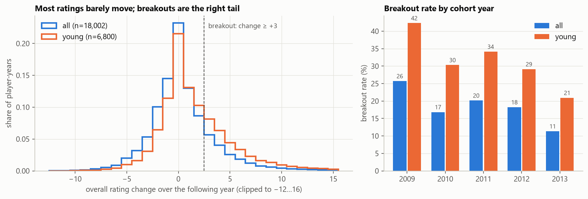
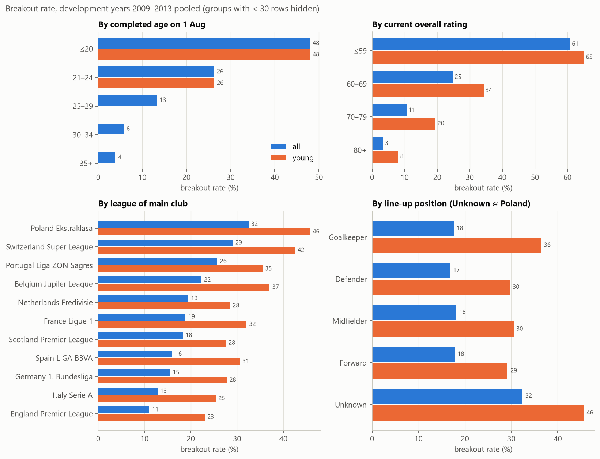
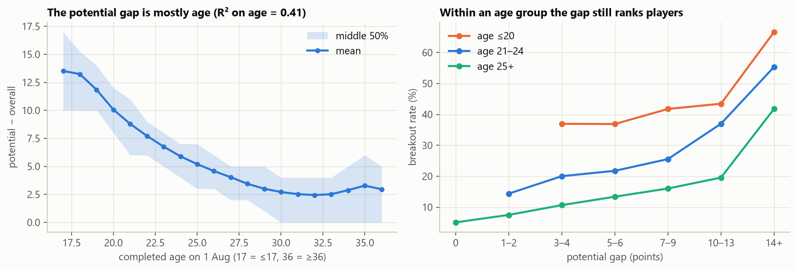
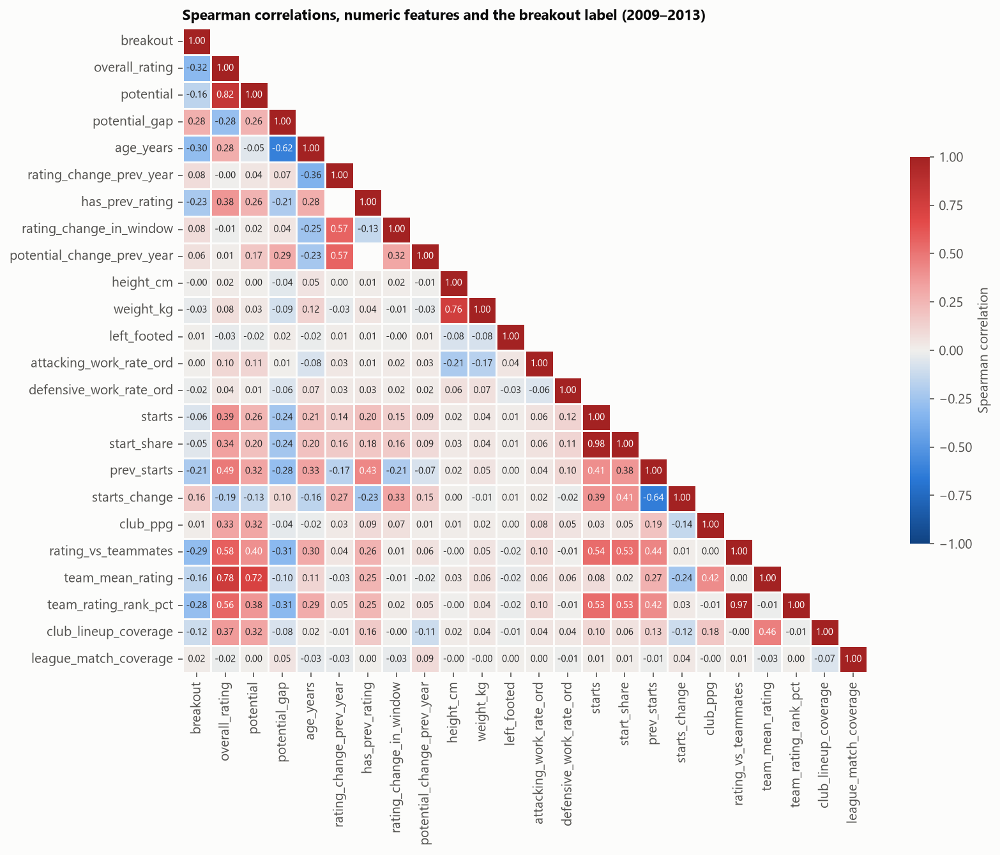
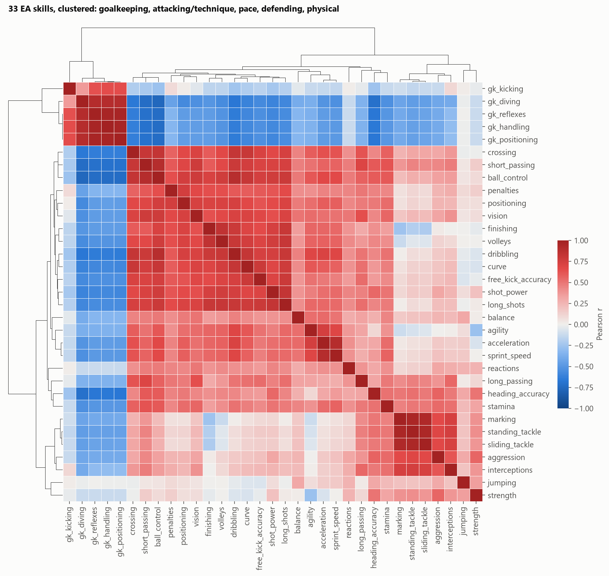
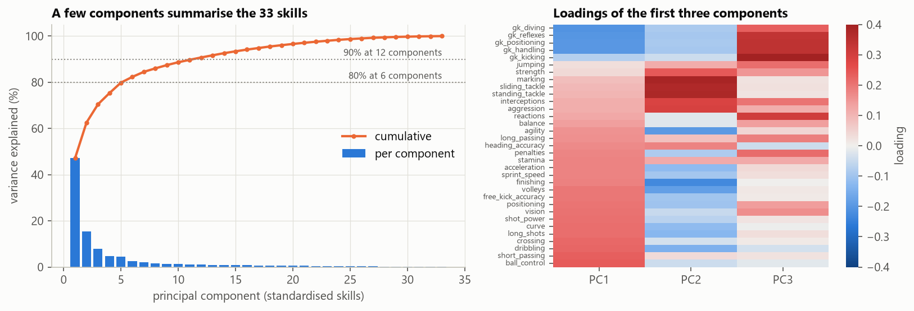
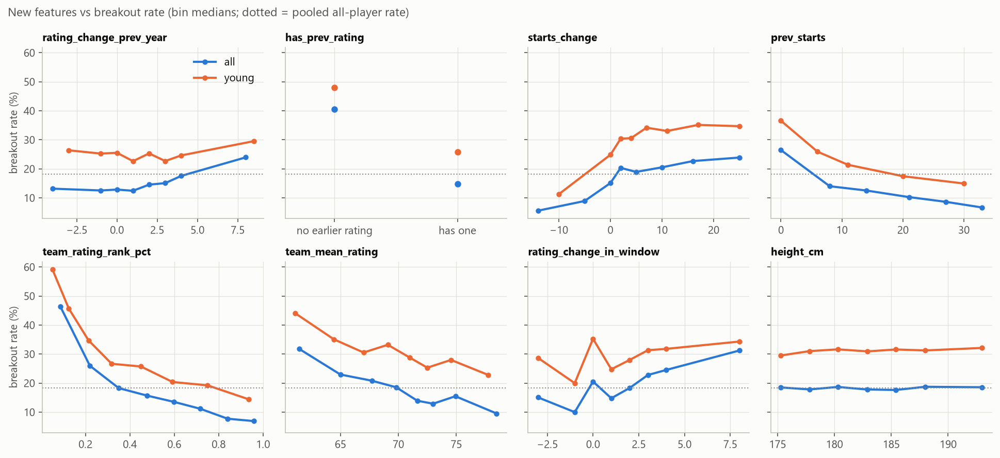
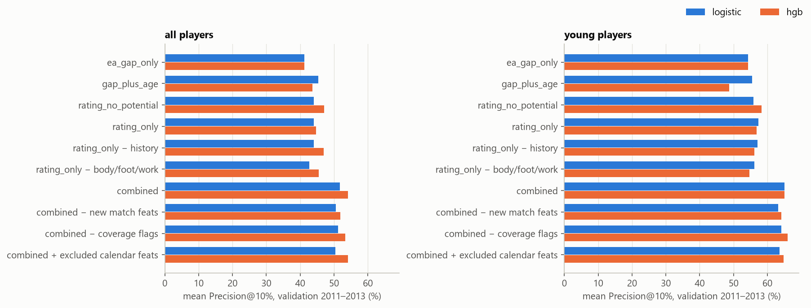

# 3. Exploration, correlations and feature engineering

All statistics in this section use the development years 2009–2013 (18,002 player-years, 7,200
players; 6,800 young player-years). The 2014 test labels were not looked at. Code:
`src/features.py` and `src/eda.py`; narrated notebook: `02_exploration_features.ipynb`; tables:
`tables/`. Associations below are correlations in observational data. They help rank
players, but they do not show that changing a feature would cause a breakout.

## The outcome

Most ratings barely move. The median one-year change is 0 in every year and the distribution has a
long right tail (Figure 1). The breakout rate (change ≥ +3) falls from 26% in 2009 to 11% in 2013.
Young players break out about twice as often (42% → 21%). Because prevalence drifts, every metric
is computed within a year and compared with that year's random baseline.

## Which variables are related to breakouts?

**Age and current rating dominate** (Figure 2). Players aged 20 or younger broke out 48% of the
time, against 13% at 25–29 and 6% at 30–34. Players rated below 60 broke out 61% of the time,
against 3% for those rated 80+. A low rating leaves room to rise. Leagues differ from 11% (England)
to 32% (Poland), partly because their age and rating mixes differ.

**Position barely matters once the data artefact is removed.** Known positions all sit at 17–18%.
The high rate for "Unknown" position (32%) is a league effect: 801 of the 808 rows without a
position are Polish, because Polish line-ups lack pitch coordinates.

**EA's potential gap is largely age** (Figure 3). Age alone explains 41% of the variance of
potential − overall (25% among young players). Ranking all players by age alone (younger first)
gives an AUC of 0.72, slightly above the gap's 0.70. The gap adjusted for age keeps an AUC of only
0.58. Within each age group the gap still ranks players (right panel), so EA's potential does carry
some information beyond age, but much less than the raw gap suggests. This matters for the
circularity concern (potential and the label both come from EA). It is why we test a feature set
without potential.

**Correlations between features** (Figure 4, Spearman). The strongest single associations with
breakout are overall rating (ρ = −0.32), age (−0.30), rating relative to teammates (−0.30), squad
rank (−0.28) and the potential gap (+0.28). Several predictors are redundant: `starts` and
`start_share` (ρ = 0.98), `rating_vs_teammates` and squad rank (0.97), overall and potential (0.82),
and height and weight (0.76). Club points per game, height, weight, foot and work rates show no
marginal association.

**The 33 skills are highly redundant** (Figure 5). Twenty-four skill pairs have |r| > 0.8,
for example the goalkeeping skills with each other (r ≈ 0.98) and marking with standing tackle
(0.95). In a PCA of the standardised skills, 6 components explain 80% of the variance and 12 explain
90% (Figure 7). The first component separates outfield players from goalkeepers, the second
defenders from attackers.

## New features

Each new feature uses only data dated before the row's 1 August cut-off (Figure 6):

| Feature | Definition | Finding |
|---|---|---|
| `rating_change_prev_year` | rating now − latest rating 1–2 years earlier | mild positive slope (momentum) |
| `has_prev_rating` | a rating exists 1–2 years earlier | players new to EA's data: 40% vs 15% |
| `rating_change_in_window` | rating now − first rating in the last 12 months | mild positive |
| `potential_change_prev_year` | same as momentum, for potential | weak |
| `prev_starts`, `starts_change` | starts last season; change in starts | more starts than last season → more breakouts |
| `team_mean_rating`, `team_rating_rank_pct` | squad's mean rating; player's rank in it | low rank in a strong squad → more breakouts |
| `height_cm`, `weight_kg`, `left_footed`, work rates | player table / EA tags | no marginal association |
| `club_lineup_coverage` | share of the club's line-up slots with an ID (from cleaning) | data-quality covariate |

Two engineered features were **rejected**: the number of rating updates in the past year and the
days since the last rating. EA moved from two updates a year to near-monthly updates in 2013, so
these mostly encode the calendar. Their within-year association fades or flips sign by 2012–13.

**Do the groups add signal?** We ran a quick screen on the rolling validation years 2011–2013
(train on earlier years). It used two fixed, untuned models: logistic regression and gradient
boosting (Figure 8). This is not model selection. Ranking by EA's gap gives a mean Precision@10% of
0.41 (young: 0.54). The rating features without potential reach 0.44–0.47 (young 0.56–0.58).
Adding potential changes this by only 1–2 points, in no consistent direction. Adding match history
lifts it to 0.52–0.54 (young 0.65). Most of that gain comes from `starts`/`start_share`: at a given
rating and age, players who started less are more likely to rise. The new match features add about
one point. Differences of 1–2 points are within year-to-year noise.

## Feature sets, encoding and scaling

| Set | Columns |
|---|---|
| `ea_gap_only` | potential gap (EA baseline) |
| `rating_no_potential` (44) | overall, 33 skills, rating history, age, height, weight, foot, work rates, league |
| `rating_only` (47) | the above + potential, potential gap, potential change |
| `combined` (58) | the above + starts, start share, club points per game, rating vs teammates, previous starts, change in starts, squad mean rating and rank, line-up coverage, position |

Preprocessing is fitted inside each model pipeline on the training rows of each fold only:

- **Imputation:** median for numeric columns. Informative gaps get explicit flags
  (`has_prev_rating`, `has_prev_season`).
- **Scaling:** standardisation for linear models only. Tree models are unaffected by monotone
  scaling.
- **Categoricals:** league and position are one-hot encoded. Missing position becomes "Unknown",
  and unseen categories are ignored.
- **Work rates:** these are ordered, so low/medium/high is coded as 0/1/2.
- **PCA (optional):** principal components of the standardised skills, offered to the linear model
  to handle their redundancy.
