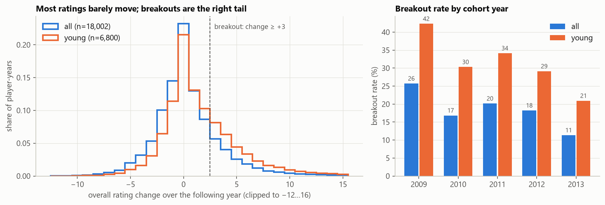
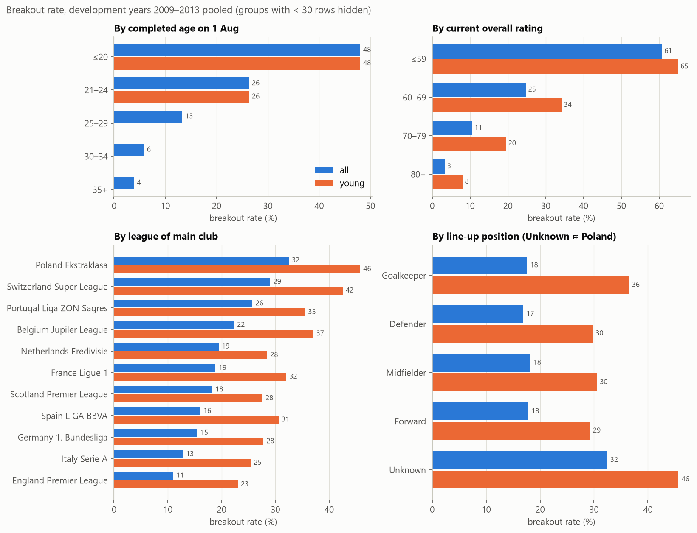
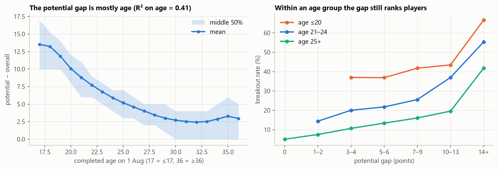
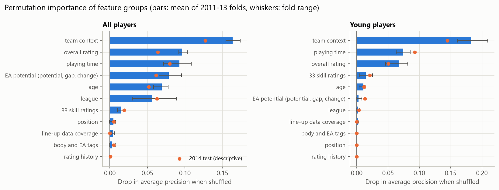
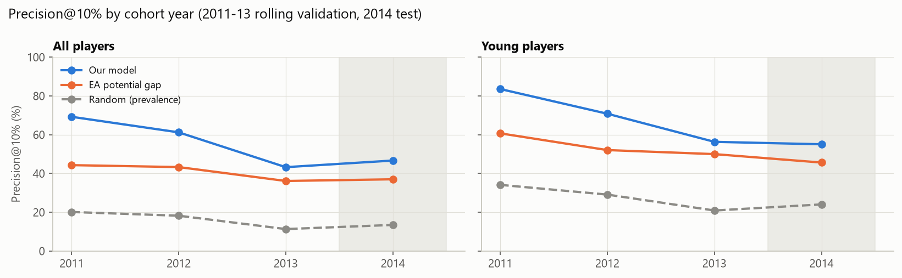
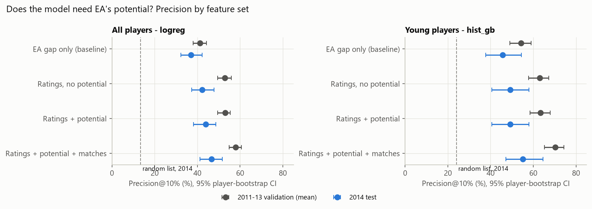
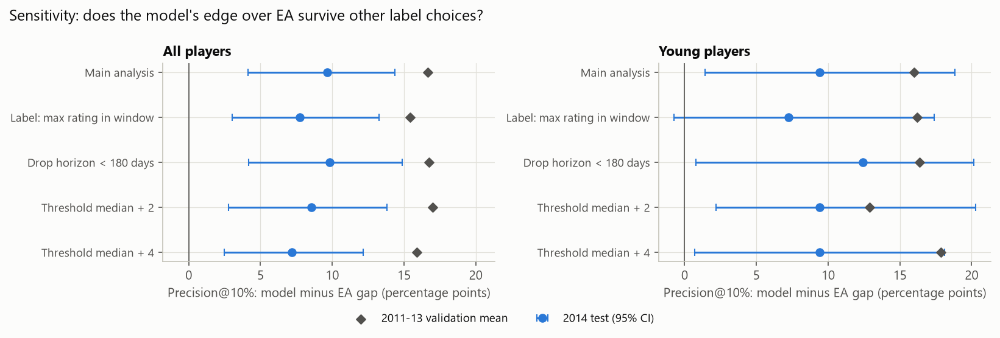

# Predicting Breakout Football Players — Draft Report

**Team:** Shiyan Wang, Junius, Noah Feng, Xianghe Meng · IDSC-GH 5010 Introduction to Data Science, Fall 2026

*Draft for the 1 December check-in. Sections 1–3 were shown at the first check-in; sections 4–6 are new.*

## 1. Problem and data

### The question

A club's scouts cannot watch every player, so they need a short list. We ask: using what is known
on 1 August, can we pick the players whose FIFA overall rating will jump over the next year? We call
such a jump a **breakout**. A player breaks out if his latest rating in the 12 months after 1 August
is at least 3 points higher than his latest rating in the 12 months before, after taking away the
median change of all players that year. The median change is 0 in every year from 2009 to 2014, so in
practice a breakout means a rise of 3 points or more.

The action is simple. Every 1 August the scouts take the top 10% of our ranking and follow those
players. We judge a ranking by **Precision@10%**: the share of the watched players who really break
out. We run everything twice, for all players and for young players (24 or younger on 1 August),
because young players are the ones scouts care about most.

### One data point

One row is one player in one year, for players who started at least one league match in the season
that just ended. For example, on 1 August 2011 Mark Davies had started 9 matches. His latest rating
was 72 and his potential was 78. His latest rating in the next 12 months was 75. The change of +3
equals the median (0) plus 3, so this row is a breakout. Everything except the later rating is known
on 1 August.

### How much data

The European Soccer Database has 25,979 matches from 11 European top leagues (2008/09 to 2015/16),
11,060 players and 183,978 dated FIFA rating records. From 29,149 player-years of starters
(2009–2015) we get 25,502 rows for 8,903 players who have a rating both before and after 1 August.
That is 3,317 to 3,871 rows per year, and between 11% and 26% of them break out depending on the
year. 9,687 rows (4,724 players) are young players.

We split by time. 2009–2010 are only used for training, 2011–2013 for validation, and 2014 (3,629
rows) is the final test, used once. We drop 2015 because the ratings stop on 7 July 2016, before
its follow-up year ends.

### Useful variables

* From the rating on 1 August: overall rating, EA's potential, the gap between them, and 33 skills.
* From the player: age, height, weight, preferred foot, work rates.
* From last season's line-ups: number of starts, share of the club's matches started, position,
  the club's points per game, and how his rating compares with his teammates.
* The league.

Because our label is an EA rating, we also test models that do not use EA's potential at all.

### Source

Mathien, H. (2016). *European Soccer Database*, version 10. Kaggle.
https://www.kaggle.com/datasets/hugomathien/soccer. The matches and line-ups come from
football-data.mx-api.enetscores.com and the ratings from sofifa.com (EA Sports FIFA). The database
is under the Open Database Licence and the author asks for non-commercial use only. We use it for
coursework.

## 2. Data cleaning and preparation

All cleaning is in `src/cleaning.py` and is shown in `01_data_cleaning.ipynb`. Every check and its
count is saved in `data/cleaning_audit.csv`.

**Missing values.** 836 rating records (0.5%) are completely empty. Each one sits next to a valid
record for the same player and date, so we drop them. Seven skills (such as volleys and curve) did
not exist in older FIFA games, so they are missing for 199 of our 2009 rows. We leave them missing and
fill them with the median inside each training fold. The bigger problem is the line-ups: 29,257 of
571,538 line-up slots have no player ID. All 1,516 completely missing team line-ups are from 2008/09
in Belgium, the Netherlands, Poland, Portugal and Switzerland. Poland also has no pitch positions
from 2008/09 to 2012/13, so 801 of the 808 rows without a position are Polish. We keep these rows,
because dropping them would remove most of 2009 in five leagues. Instead we add
`club_lineup_coverage` (the share of the club's line-up slots that have an ID) and `position_missing`.

**Duplicates.** There are no duplicate matches and no duplicate player IDs. 212 players share a name
with someone else but never the birthday, so we always join on IDs. In 13 matches a home player is
also listed in an away slot (usually the goalkeeper copied into slot 11); we count him once, for the
home team.

**Inconsistent entries.** We read positions from the pitch coordinates in the line-ups. Looking at
the formations, Y = 1 is the goalkeeper, 3 is the back line, 5–9 are midfield lines and 10–11 are
strikers. Y = 0 only appears with X = 0 and is a placeholder, so we treat it as missing. The work-rate
fields contain odd codes such as "None", "norm" and "_0"; we set those to missing. Belgium 2013/14
only has 12 play-off matches between 4 clubs, so the 2014 test year has only 69 Belgian players
instead of about 290. We flag this with `league_match_coverage`.

**Types and units.** Dates are read as dates, IDs as integers, and all ratings are checked to be
numbers between 0 and 100. Height is in centimetres (157–208) and weight in pounds (117–243); we
convert weight to kilograms. Age is in completed years on 1 August.

**Unusual values.** Goals range from 0 to 10 and BMI from 17.6 to 30.9, which are normal, so we do
not remove any players. We do remove 21 rating records that are isolated spikes: at least 8 points
away from both neighbouring records while the neighbours agree (for example 53, 53, 44, 54). These
are typing errors. This removes 1 row and changes 1 label. We keep 1,071 records where potential is
below overall and 385 rows where the rating changed by 10 or more points, because those are EA's own
decisions, not errors.

**Building the rows.** For each 1 August we take the latest rating in the 12 months before and the
latest rating in the 12 months after. Two problems remain, and we report both as limitations:

* **Missing follow-up.** Of the 28,810 player-years with a rating on 1 August (all years together),
  3,308 (11.5%) have no rating in the following year, so we cannot label them. Per year this is
  9–13%. These players are older (27.6 vs 26.1), rated lower (64.8 vs 70.3), started fewer matches
  (10.7 vs 16.9) and come more often from small leagues (19–23% dropped in Portugal, Switzerland,
  Scotland, Belgium and Poland, 3% in England). So our results are about players who stay in EA's
  database.
* **Uneven time gaps.** The two ratings are between 7 and 696 days apart (median 365). Rows with a
  gap under 180 days break out only 5% of the time, against 18% for the rest. We keep the label as
  planned and save the gap as `horizon_days` for a sensitivity check. It uses the future rating date,
  so it is never a feature.

## 3. Exploration and features

This part only uses 2009–2013 (18,002 rows). We did not look at the 2014 labels. The code is in
`src/features.py` and `src/eda.py`, and everything is shown in `02_exploration_features.ipynb`. All of
these are correlations; they help rank players but do not show what causes a breakout.

**The outcome.** Most ratings barely move. The breakout rate falls from 26% in 2009 to 11% in 2013,
and young players break out about twice as often (Figure 1). Because the rate changes so much, we
always compare methods within the same year.

**Age and current rating matter most** (Figure 2). Players aged 20 or younger broke out 48% of the
time, against 13% at 25–29 and 6% at 30–34. Players rated below 60 broke out 61% of the time,
against 3% for players rated 80 or more. Leagues range from 11% (England) to 32% (Poland). Known
positions are all around 17–18%; the 32% for "Unknown" is really Poland.

**EA's potential gap is mostly age** (Figure 3). Age explains 41% of the variation in potential minus
overall. Ranking players by age alone (youngest first) works slightly better than ranking by the gap
(AUC 0.72 vs 0.70), and the gap with age taken out only reaches 0.58. Within an age group the gap
still helps a little. This is why we test a model without potential.

**Correlations** (Figure 4). The features most related to breakouts are overall rating (−0.32), age
(−0.30), rating compared with teammates (−0.30), rank within the team (−0.28) and the potential gap
(+0.28). Some features carry the same information: starts and start share (0.98), rating vs teammates
and team rank (0.97), overall and potential (0.82).

**The 33 skills overlap a lot** (Figures 5 and 7). 24 pairs of skills have a correlation above 0.8.
Six principal components explain 80% of their variation.

**New features** (Figure 6). All of them only use data from before 1 August.

| Feature | Meaning | What we found |
|---|---|---|
| `rating_change_prev_year` | rating now minus the rating a year earlier | small positive effect |
| `has_prev_rating` | is there a rating a year earlier | new players: 40% break out vs 15% |
| `rating_change_in_window` | change within the last 12 months | small positive effect |
| `potential_change_prev_year` | the same for potential | weak |
| `prev_starts`, `starts_change` | starts last season, and the change | more starts than before → more breakouts |
| `team_mean_rating`, `team_rating_rank_pct` | team's average rating, player's rank in it | low rank in a good team → more breakouts |
| height, weight, foot, work rates | player table and EA tags | no effect on their own |
| `club_lineup_coverage` | share of the club's line-up slots with an ID | data quality |

We built two more features, the number of rating updates in the last year and the days since the
last update, but dropped them. EA switched from two updates a year to almost monthly updates in 2013,
so these columns mostly tell you the year, not anything about the player.

**A quick check of the groups** (Figure 8). With two simple, untuned models on 2011–2013, EA's gap
alone gives about 41% Precision@10% (54% for young players). Rating features without potential give
44–47%, adding potential changes this by only 1–2 points, and adding match history brings it to
52–54% (65% for young players). So match history looks like the useful new information.

**Feature sets.** We compare four sets: EA's gap alone (1 column), ratings without potential (44),
ratings with potential (47), and ratings plus match history (58).

**Encoding and scaling.** Missing numbers are filled with the median, and where missing means
something we add a flag. Numbers are standardised for logistic regression only. League and position
are one-hot encoded, with "Unknown" for a missing position. Work rate becomes 0/1/2. The logistic
regression may replace the skills with a few principal components. All of this is fitted on the
training years only, inside each fold.

## 4. Methods, model selection and explainability

### Baselines

We compare every model with two simple rules at the same budget (top 10% of each year):

* **Random list.** Its expected precision is just the breakout rate: 16.6% for all players and
  28.1% for young players on average over 2011–2013.
* **EA's potential gap.** This is what a scout could do with the FIFA data alone, and it is already
  strong: 41.3% for all players and 54.3% for young players.

### Models

We use three models from class, each on the four feature sets:

* **Logistic regression** is our simple, explainable model. We try `C` = 0.01, 0.1 and 1, and
  optionally replace the 33 skills with 3, 5 or 10 principal components.
* **Random forest** with 300 trees. We try a minimum leaf size of 5 or 25 and √p or 0.33p features
  per split.
* **Gradient boosting** (`HistGradientBoostingClassifier`) with 300 rounds. We try learning rates of
  0.01, 0.03 and 0.1 and 3, 7 or 31 leaves.

Each model is tried with and without class weights, because only 11–26% of players break out. We
keep the grids small on purpose. With 140–380 watched players per year, precision moves by 2.5–4
points just by chance, so a finer search would mostly fit noise. Class weights changed precision by
less than one point, which makes sense because our metric only depends on the order of players.

### How we choose

We use rolling validation: train on 2009–2010 and test on 2011, train on 2009–2011 and test on
2012, train on 2009–2012 and test on 2013. A year's labels are only known a year later, so no fold
uses future information. The same player can appear in several years, but his training rows are
always from earlier years. We pick the setting with the highest mean Precision@10% over the three
years. For young players we also compared training on everyone with training on young players only,
and we tried training on the last two years only. That lost about 1 point, so we use all earlier
years.

Mean Precision@10% over 2011–2013 (best model for each feature set):

| | EA gap | Ratings, no potential | Ratings + potential | Ratings + match history |
|---|---:|---:|---:|---:|
| All players | 41.3% | 52.8% | 53.0% | **57.9%** |
| Young players | 54.3% | 64.3% | 64.8% | **70.2%** |

* The models beat EA's ranking in every validation year.
* Adding EA's potential changes precision by only 0–1.4 points.
* Adding match history adds 3.5–7 points for every model and both groups.
* The gap to EA shrinks in 2013, when the breakout rate is lowest (24.9 points in 2011, 7.1 in 2013).

**Chosen models.** For all players: logistic regression on ratings + match history (`C` = 0.1, no
class weights, skills reduced to 3 principal components). For young players: gradient boosting
trained on young players only, on the same features (learning rate 0.03, 3 leaves, balanced
weights). The top candidates are within about 1–2 points of each other, so the choice of model
family is close to a tie. The choice of features is the clear result.

### Which features matter

**Permutation importance.** We shuffle one group of related columns at a time and measure how much
average precision drops, averaged over the three validation years.

| Feature group | All players | Young players |
|---|---:|---:|
| Team context (rating vs teammates, team rating, points per game) | 0.164 | 0.183 |
| Overall rating | 0.096 | 0.068 |
| Playing time (starts, start share, change in starts) | 0.093 | 0.074 |
| EA potential (potential, gap, change) | 0.079 | 0.003 |
| Age | 0.069 | 0.010 |
| League | 0.056 | 0.002 |
| 33 skills | 0.015 | 0.015 |

Body, EA tags, position, rating history and line-up coverage each add less than 0.01.

**Direction of the effects.** These are logistic regression coefficients per standard deviation,
trained on 2009–2013 (for young players we use the best logistic regression as a stand-in for the
boosting model). Holding the other features fixed, a player is more likely to break out if he:

| | All players | Young players |
|---|---:|---:|
| started more matches | +1.03 | +0.40 |
| has a lower current rating | −0.58 | −0.37 |
| is younger | −0.51 | −0.17 |
| is rated below his teammates | −0.39 | −0.50 |
| plays in a weaker team (lower team rating) | −0.35 | – |
| plays for a club with more points per game | +0.48 | +0.21 |
| has a bigger potential gap | +0.44 | +0.32 |

In short, the model looks for regular starters at successful clubs who are still rated below the
players around them, so their rating has not caught up with their role yet. The skills enter as
three principal components and all have small coefficients. These are associations, not causes, and
correlated features should be read together.

## 5. Validation and final evaluation

The chosen models were trained on 2009–2013 and scored on 2014 once. All intervals are 95% intervals
from 1,000 bootstrap samples of players (not rows, because players repeat across years). The
difference to EA is paired: both lists are scored on the same resampled players.

| 2014 | List | Precision@10% | Recall@10% | Average precision |
|---|---|---:|---:|---:|
| All players (3,629; 489 breakouts; watch 362) | Our model | **46.7%** [41.2, 51.7] | 34.6% | 0.406 |
| | EA's gap | 37.0% [32.3, 42.3] | 27.4% | 0.294 |
| | Random | 13.5% | 10.0% | 0.135 |
| Young players (1,380; 332 breakouts; watch 138) | Our model | **55.1%** [47.1, 64.5] | 22.9% | 0.486 |
| | EA's gap | 45.7% [37.7, 54.3] | 19.0% | 0.349 |
| | Random | 24.1% | 10.0% | 0.241 |

Our model beats EA's list by **+9.7 points** [4.1, 14.4] for all players and **+9.4 points**
[1.4, 18.8] for young players. On validation the gap was bigger (+16.7 and +16.0 points). The 2014
gap is smaller for three reasons: precision falls over the years for every method along with the
breakout rate, we chose the models on the validation years so those scores are a bit optimistic,
and 2014 is only one season. The model beat EA in every year and at every budget from 1% to 30%,
so 10% is not a lucky choice.

### Does the model just copy EA's potential?

EA's potential is EA's own guess about growth, and our label is also an EA rating. If our advantage
came only from potential, removing it should remove the advantage. Paired differences in
Precision@10% for the chosen model:

| | All: validation | All: 2014 | Young: validation | Young: 2014 |
|---|---:|---:|---:|---:|
| Ratings without potential, minus EA's gap | +11.5 [8.5, 14.5] | +5.2 [0.3, 10.5] | +8.7 [3.0, 14.4] | +3.6 [−6.5, 14.5] |
| Adding potential | +0.2 [−1.5, 1.3] | +1.7 [−1.4, 3.0] | +0.5 [−2.8, 3.5] | 0.0 [−6.5, 5.1] |
| Adding match history | +5.0 [2.9, 7.4] | +2.8 [−1.1, 6.9] | +6.8 [2.5, 10.8] | +5.8 [−0.7, 13.8] |

Without potential, a model with only ratings, age and league already beats EA's list. Adding
potential changes almost nothing, because age and current rating already hold most of its
information. Match history is the information that does not come from EA.

As a check that does not use EA at all, we counted league starts in 2014/15. After adjusting for last
season's starts, age and rating, the players on our list started about as many matches as similar
players (+0.1 [−1.1, +1.4]; young +1.1 [−0.9, +3.2]), while EA's picks started a bit fewer (−1.4
[−2.7, −0.2]; young −0.4 [−2.4, +1.6]). This is weak evidence. It suggests the model is not just
following EA's bookkeeping, but it does not show that our players really got better on the pitch.

### Sensitivity checks

We rebuilt the labels in other ways and reran the chosen models through all folds and the 2014 test.

| Label | Breakout rate 2014 | Model minus EA, all players | Model minus EA, young |
|---|---:|---:|---:|
| Main analysis | 13.5% | +9.7 [4.1, 14.4] | +9.4 [1.4, 18.8] |
| Highest rating in the next year instead of the last | 14.9% | +7.7 [3.0, 13.3] | +7.2 [−0.7, 17.4] |
| Drop rows with ratings less than 180 days apart | 14.1% | +9.8 [4.2, 14.9] | +12.4 [0.8, 20.2] |
| Median + 2 instead of + 3 | 21.8% | +8.6 [2.8, 13.8] | +9.4 [2.2, 20.3] |
| Median + 4 instead of + 3 | 8.0% | +7.2 [2.5, 12.2] | +9.4 [0.7, 18.1] |

The model beats EA in every case. Only one interval includes 0 (young players with the highest-rating
label). So the result does not depend on how exactly we define a breakout.

## 6. Results and conclusions

### What the scouting list would have found

On 1 August 2014 a scout follows 362 players (10% of all starters):

| List | Breakouts found |
|---|---|
| Our model | **169** [149, 187] |
| EA's potential gap | 134 [117, 153] |
| Random list | about 49 (95% of random lists find 37–61) |

That is 35 more breakouts than EA's list for the same effort, and about 3.5 times a random list. For
young players (138 watched) the numbers are 76, 63 and 33.

The two lists share 182 of their 362 players, and half of those shared players break out. The 180
players only our model picks break out 42% of the time, while the 180 only EA picks break out 23% of
the time. So our model mainly replaces EA's weakest picks. EA's list is very young (77% aged 21 or
under) with big potential gaps. Ours is a little older (65% aged 21 or under), with smaller gaps,
more starts last season (12.4 vs 10.8) and lower current ratings (61.7 vs 64.5). It also leans
towards leagues where EA raises ratings more often; for example it picks 59 players from Poland, of
whom 23 break out, while EA's list has 16.

### What a scout should do

1. Rank players with the model instead of EA's potential gap. At the same 10% budget, expect about
   47% of the list to break out (55% for young players), against 37% (46%) for EA's list.
2. Look for regular starters at good clubs who are still rated below their teammates. Use the
   potential gap only as a tie-breaker.
3. Use the list to decide whom to watch, not whom to sign. About half of the players on it will not
   break out.
4. Retrain the model every summer on all finished seasons.

### Assumptions and limitations

* **EA ratings are subjective.** A breakout means EA raised the rating; it does not prove the player
  improved. The model without potential and the starts check make this less of a concern, but do not
  remove it. Part of the model's edge comes from predicting how EA re-rates players.
* **Missing follow-up.** 11.5% of player-years have no rating a year later and are left out. A real
  list would include some of them, so real precision is probably a bit lower.
* **Uneven time gaps** between the two ratings. Dropping short gaps does not change the result.
* **Missing line-ups** in Poland, Belgium and 2008/09 make the starts and team features weaker there,
  and Belgium has only 69 players in 2014. Our list also leans towards Poland, and we did not test
  leaving these leagues out.
* **One test year.** 2014 is a single season and the breakout rate changes from 11% to 26% between
  years, so the exact precision will differ in other seasons. The gap to EA has been more stable.
* **Correlation, not causation.** The importance scores and coefficients show what the model uses,
  not what makes players improve.

## References

* Mathien, H. (2016). *European Soccer Database*, version 10. Kaggle. https://www.kaggle.com/datasets/hugomathien/soccer
* Pedregosa, F. et al. (2011). Scikit-learn: Machine Learning in Python. *JMLR* 12, 2825–2830.
* Code: this folder (`src/` and the four notebooks). AI tools were used to help write and debug code;
  all analysis choices and text are our own.
