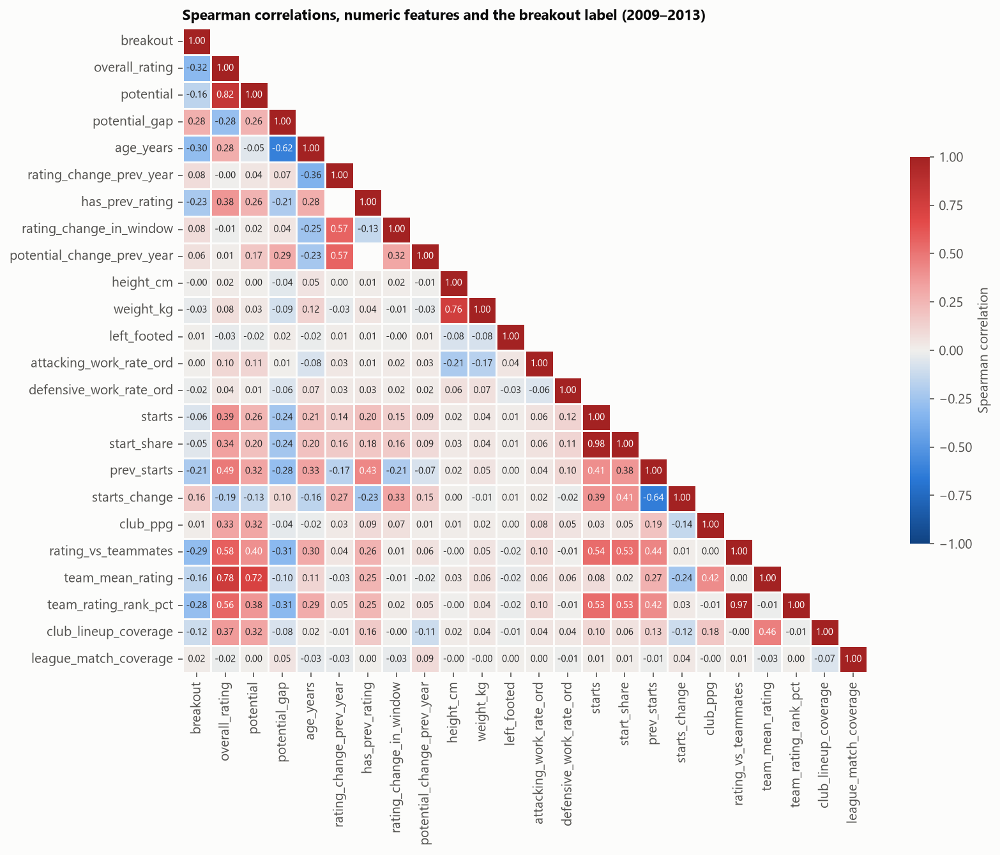
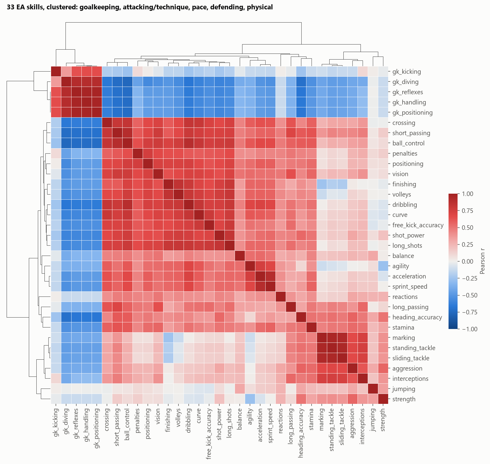
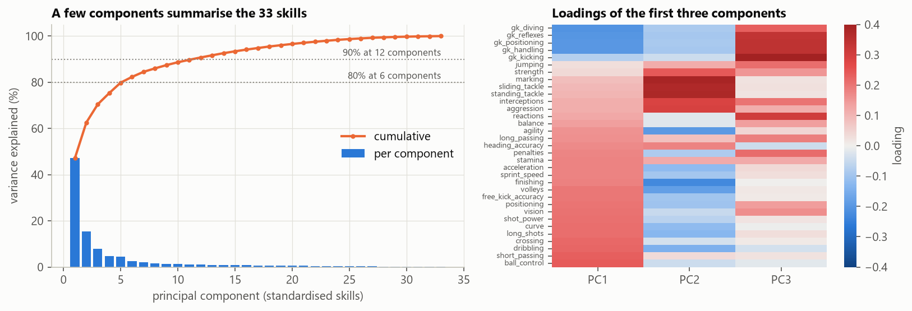
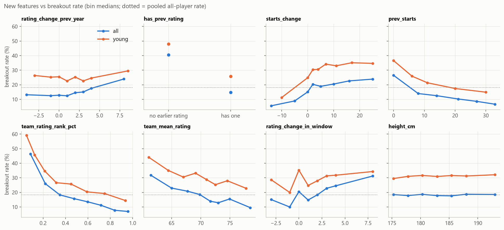
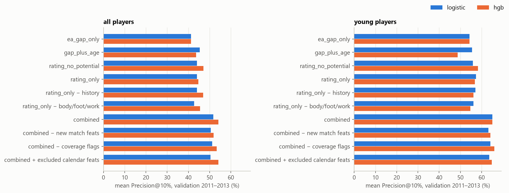
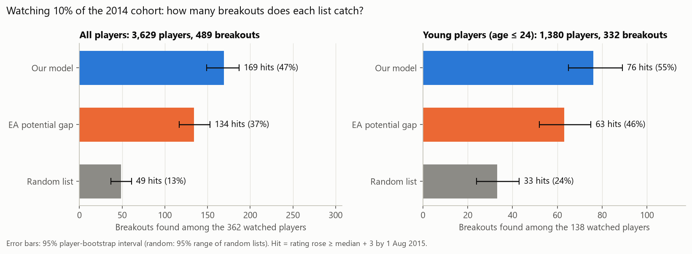

# Predicting Breakout Football Players — draft report (check-in 2, 1 Dec)

**Team:** Shiyan Wang, Junius, Noah Feng, Xianghe Meng · IDSC-GH 5010, Fall 2026

> Draft for feedback. Sections 1–3 were first shown at check-in 1 (`A_checkin_1124/report/`);
> sections 4–5 are new. This file is the living draft; the final version goes to `C_final_1208/`.

**Summary.** On 1 August of each year we rank the players who started a league match in the season
just finished and watch the top 10%. A "breakout" is a rise in EA's FIFA overall rating of at least the
year's median change plus 3 points by the next 1 August. Trained on 2009–2013 and tested once on 2014,
our model's watchlist caught 169 of 489 breakouts (46.7%), against 134 (37.0%) for EA's own
potential-minus-overall ranking and about 49 (13.5%) for a random list; for young players (≤ 24) it
caught 76 against 63 and 33. The edge does not depend on EA's potential, and match history (playing
time and team context) is the information that EA's ratings do not already contain.

| Course part | Section |
|---|---|
| Problem and dataset | 1 |
| Data cleaning and preparation | 2 |
| Exploration, correlations, feature engineering | 3 |
| Methods, model selection | 4 |
| Validation and final evaluation, explainability | 4 (design), 5.1–5.4 |
| Results, action, assumptions and limitations | 5.2, 5.5–5.7 |

# 1. Problem and dataset

## Problem and why it matters

Clubs cannot scout every player. A scouting department that can watch only one player in ten needs to
know whom to watch. We ask whether data available on 1 August of a year can pick out the players whose
FIFA overall rating will rise unusually fast over the next year, the "breakouts". A player breaks out if
the player's latest overall rating in the 12 months after 1 August is at least 3 points above the latest rating
in the 12 months before, after subtracting that year's median change across all players. That median is 0 in every year
2009–2014, so in practice a breakout is a rise of 3 or more points. The action is a watchlist of the top
10% (rounded down) of each year's cohort. We judge it by Precision@10%, the share of the watchlist who
break out. We study all players and, separately, young players (completed age ≤ 24 on 1 August), the
group scouts care about most.

## One data point

One row is one player in one prediction year, for a player who started at least one league match in
the season just finished. Example: on 1 August 2011 Mark Davies had started 9 matches. The latest overall
rating was 72 and EA's potential was 78. The latest rating in the following 12 months was 75. The
change of +3 is at least the median (0) plus 3, so the row is a breakout. Everything except the later
rating is known on 1 August.

## How many data points

The source holds 25,979 matches in 11 top European leagues (2008/09–2015/16), 11,060 players and
183,978 dated rating records. From 29,149 starter-years (2009–2015) we obtain 25,502 rows for 8,903
players that have both a current and a follow-up rating. That is 3,317–3,871 rows per year, with a
breakout rate between 11.3% and 25.7% by year. The young subset has 9,687 rows (4,724 players). 2009–2010
are used only for training, 2011–2013 for rolling validation (18,002 rows in 2009–2013), and 2014
(3,629 rows) is the final test, used once. 2015 (3,871 rows) is dropped because the ratings end on
7 July 2016, before its follow-up window closes.

## Seemingly useful features

- From the current rating snapshot: overall rating, EA's potential, and the gap between them. The EA
  baseline ranks players by this gap. Also 33 skill ratings and the date of the snapshot.
- From the player: age.
- From last season's lineups: number of starts, share of the club's matches started, the most common
  pitch position, club points per game, and the rating compared with teammates.
- Context: league.

Because the label is also an EA rating, we test models without EA's potential and compare rating-only
with rating-plus-match-history feature sets.

## Data source

Mathien, H. (2016). *European Soccer Database* (version 10, 23 Oct 2016). Kaggle.
https://www.kaggle.com/datasets/hugomathien/soccer. SQLite file, 313 MB. Licence: "Database: Open
Database, Contents: © Original Authors" (Open Database Licence for the database). The author asks for
no commercial use. The data come from football-data.mx-api.enetscores.com (matches, lineups and
formations) and sofifa.com (EA Sports FIFA player ratings; FIFA data are EA Sports' property). We use
it for non-commercial coursework only.

# 2. Data cleaning and preparation

All steps are in `src/cleaning.py`. Every check and count is written to `A_checkin_1124/data/cleaning_audit.csv`.

**Missing values.** 836 rating records (0.5%) are completely empty. Each sits on the same player and
date as a valid record, so we drop them. Seven skills (volleys, curve, agility, balance, jumping,
vision, sliding tackle) did not exist in older FIFA editions. They are missing in 1,877 records dated
before March 2010, which is 199 rows of our 2009 cohort. We leave them missing, and the median imputer
fills them inside each training fold. Lineups are the main gap: 29,257 of 571,538 lineup slots have no
player ID. All 1,516 fully missing team lineups are from 2008/09, in Belgium, the Netherlands, Poland,
Portugal and Switzerland (43–68% of their team-matches). Poland also has no pitch coordinates from
2008/09 to 2012/13, so 801 of the 808 rows without a position are Polish. Their high breakout rate
(32%) is a league effect, not a position effect. We keep these rows. Instead we add
`club_lineup_coverage` (share of the club's lineup slots filled, below 0.9 for 1,682 rows, mostly 2009)
and `position_missing`, because dropping them would remove most of 2009 in five leagues.

**Duplicates.** There are no duplicate match IDs and no duplicate (league, season, date, home, away)
fixtures. Player IDs are unique. 212 extra rows share a name, but never with the same birthday, so we
join on IDs, never names. Valid ratings have no duplicate player-date pairs. In 13 matches a home player
also appears in an away slot (usually the home goalkeeper copied into slot 11). We keep the home entry
and count each player once per match. The cleaned table is asserted to have one row per (year, player).

**Inconsistent entries.** Pitch Y coordinates were binned wrongly at first. Formations show that Y=5–9
are midfield lines: 5/6 holding, 7 central, 8 behind a lone striker, 9 the tip of a diamond. Only
Y=10–11 are strikers, and Y=0 (always with X=0) is a placeholder. Correcting the bins moved 464 rows into
Midfielder. EA work-rate fields contain stray codes ('None', 'norm', '_0', digits; about 4,300 and
6,800 records), which the feature code sets to missing. Belgium 2013/14 contains only 12 play-off
matches between 4 clubs, and Italy and Switzerland 2011/12 are 94% and 90% complete. We add
`league_match_coverage`. As a result the 2014 test year has 69 Belgian rows instead of about 290.

**Data types and units.** Dates are parsed as dates, IDs as integers, and ratings are checked to be
numeric and within 0–100. Height is stored in centimetres converted from whole inches (157–208 cm), and
weight is in pounds (117–243 lb, converted to kg for features). Age is measured in completed years on
1 August.

**Unusual values.** Goals range from 0 to 10, which is plausible. BMI ranges from 17.6 to 30.9, also
plausible, so no player outliers are removed. 21 rating records are isolated spikes: at least 8 points
from both neighbours, which agree with each other (for example 53, 53, 44, 54). We remove them as entry
errors. This drops 1 row and flips 1 label, and the 2013 EA baseline moves from 36.4% to 36.1%. We keep
1,071 records where potential is below overall (EA's own judgment) and 385 rows whose one-year change
is 10 points or more (−16 to +32), because these are EA re-ratings, not errors.

**Preparation and known biases.** For each 1 August we take the latest rating in the previous 12
months and the latest in the next 12 months. A rating on 1 August itself counts as follow-up. Of
28,810 starters with a current rating, 11.48% have no follow-up rating and cannot be labelled. They are
older (27.6 vs 26.1), lower rated (64.8 vs 70.3), started fewer matches (10.7 vs 16.9) and come mostly
from smaller leagues (19–23% excluded in Portugal, Switzerland, Scotland, Belgium and Poland, 3% in
England). Our results therefore describe players who stay in EA's database. The gap between the two
ratings varies from 7 to 696 days (median 365). The 243 validation-period rows with gaps under 180
days (all from 2013) break out only 5.3% of the time, against 18.4% otherwise. We keep the agreed label
and store `horizon_days` for a sensitivity check. It uses the outcome date, so it is never a feature.
The 2014 follow-up window is complete (ratings run to 31 July 2015).

# 3. Exploration, correlations and feature engineering

All statistics in this section use the development years 2009–2013 (18,002 player-years, 7,200
players; 6,800 young player-years). The 2014 test labels were not looked at. Code:
`src/features.py` and `src/eda.py`; narrated notebook: `A_checkin_1124/02_exploration_features.ipynb`; tables:
`A_checkin_1124/tables/`. Associations below are correlations in observational data. They help rank
players, but they do not show that changing a feature would cause a breakout.

## The outcome

Most ratings barely move. The median one-year change is 0 in every year and the distribution has a
long right tail (Figure 1). The breakout rate (change ≥ +3) falls from 26% in 2009 to 11% in 2013.
Young players break out about twice as often (42% → 21%). Because prevalence drifts, every metric
is computed within a year and compared with that year's random baseline.

## Which variables are related to breakouts?

**Age and current rating dominate** (Figure 2). Players aged 20 or younger broke out 48% of the
time, against 13% at 25–29 and 6% at 30–34. Players rated below 60 broke out 61% of the time,
against 3% for those rated 80+. A low rating leaves room to rise. Leagues differ from 11% (England)
to 32% (Poland), partly because their age and rating mixes differ.

**Position barely matters once the data artefact is removed.** Known positions all sit at 17–18%.
The high rate for "Unknown" position (32%) is a league effect: 801 of the 808 rows without a
position are Polish, because Polish line-ups lack pitch coordinates.

**EA's potential gap is largely age** (Figure 3). Age alone explains 41% of the variance of
potential − overall (25% among young players). Ranking all players by age alone (younger first)
gives an AUC of 0.72, slightly above the gap's 0.70. The gap adjusted for age keeps an AUC of only
0.58. Within each age group the gap still ranks players (right panel), so EA's potential does carry
some information beyond age, but much less than the raw gap suggests. This matters for the
circularity concern (potential and the label both come from EA). It is why we test a feature set
without potential.

**Correlations between features** (Figure 4, Spearman). The strongest single associations with
breakout are overall rating (ρ = −0.32), age (−0.30), rating relative to teammates (−0.30), squad
rank (−0.28) and the potential gap (+0.28). Several predictors are redundant: `starts` and
`start_share` (ρ = 0.98), `rating_vs_teammates` and squad rank (0.97), overall and potential (0.82),
and height and weight (0.76). Club points per game, height, weight, foot and work rates show no
marginal association.

**The 33 skills are highly redundant** (Figure 5). Twenty-four skill pairs have |r| > 0.8,
for example the goalkeeping skills with each other (r ≈ 0.98) and marking with standing tackle
(0.95). In a PCA of the standardised skills, 6 components explain 80% of the variance and 12 explain
90% (Figure 7). The first component separates outfield players from goalkeepers, the second
defenders from attackers.

## New features

Each new feature uses only data dated before the row's 1 August cut-off (Figure 6):

| Feature | Definition | Finding |
|---|---|---|
| `rating_change_prev_year` | rating now − latest rating 1–2 years earlier | mild positive slope (momentum) |
| `has_prev_rating` | a rating exists 1–2 years earlier | players new to EA's data: 40% vs 15% |
| `rating_change_in_window` | rating now − first rating in the last 12 months | mild positive |
| `potential_change_prev_year` | same as momentum, for potential | weak |
| `prev_starts`, `starts_change` | starts last season; change in starts | more starts than last season → more breakouts |
| `team_mean_rating`, `team_rating_rank_pct` | squad's mean rating; player's rank in it | low rank in a strong squad → more breakouts |
| `height_cm`, `weight_kg`, `left_footed`, work rates | player table / EA tags | no marginal association |
| `club_lineup_coverage` | share of the club's line-up slots with an ID (from cleaning) | data-quality covariate |

Two engineered features were **rejected**: the number of rating updates in the past year and the
days since the last rating. EA moved from two updates a year to near-monthly updates in 2013, so
these mostly encode the calendar. Their within-year association fades or flips sign by 2012–13.

**Do the groups add signal?** We ran a quick screen on the rolling validation years 2011–2013
(train on earlier years). It used two fixed, untuned models: logistic regression and gradient
boosting (Figure 8). This is not model selection. Ranking by EA's gap gives a mean Precision@10% of
0.41 (young: 0.54). The rating features without potential reach 0.44–0.47 (young 0.56–0.58).
Adding potential changes this by only 1–2 points, in no consistent direction. Adding match history
lifts it to 0.52–0.54 (young 0.65). Most of that gain comes from `starts`/`start_share`: at a given
rating and age, players who started less are more likely to rise. The new match features add about
one point. Differences of 1–2 points are within year-to-year noise.

## Feature sets, encoding and scaling

| Set | Columns |
|---|---|
| `ea_gap_only` | potential gap (EA baseline) |
| `rating_no_potential` (44) | overall, 33 skills, rating history, age, height, weight, foot, work rates, league |
| `rating_only` (47) | the above + potential, potential gap, potential change |
| `combined` (58) | the above + starts, start share, club points per game, rating vs teammates, previous starts, change in starts, squad mean rating and rank, line-up coverage, position |

Preprocessing is fitted inside each model pipeline on the training rows of each fold only:

- **Imputation:** median for numeric columns. Informative gaps get explicit flags
  (`has_prev_rating`, `has_prev_season`).
- **Scaling:** standardisation for linear models only. Tree models are unaffected by monotone
  scaling.
- **Categoricals:** league and position are one-hot encoded. Missing position becomes "Unknown",
  and unseen categories are ignored.
- **Work rates:** these are ordered, so low/medium/high is coded as 0/1/2.
- **PCA (optional):** principal components of the standardised skills, offered to the linear model
  to handle their redundancy.

# 4. Methods, model selection and validation

## Baselines

We compare every model with two simple scouting rules, each applied to the same budget (watch the top 10% of each
year's cohort):

- **Random selection.** Its expected Precision@10% equals the year's breakout rate (16.6% for all players and 28.1% for
  young players, averaged over 2011–2013).
- **EA's potential gap.** Rank players by EA's *potential − overall*. This is what a scout could do with the FIFA data
  alone, and it is already strong: 41.3% for all players and 54.3% for young players.

## Methods

We fit three classifiers covered in class. Each one is fitted on four feature sets that add information step by step:

1. EA gap only.
2. Rating features without potential: current skills, rating history, age, body, league.
3. Rating features with EA's potential.
4. Rating plus match history: starts, share of club matches started, club points per game, rating relative to
   teammates, previous-season starts, pitch position.

The three classifiers:

- **Logistic regression** is our interpretable linear reference. Inputs are median-imputed and standardised, league and
  position are one-hot encoded, and L2 regularisation handles the strongly correlated skills. As an alternative, the 33
  skills can be replaced by 3, 5 or 10 principal components.
- **Random forest** captures non-linear effects and interactions without scaling.
- **Gradient boosting** (`HistGradientBoostingClassifier`) is usually the most accurate method on tabular data.

The hyperparameter grids are small on purpose:

| Model | Fixed settings | Tuned settings |
|---|---|---|
| Logistic regression | — | regularisation `C` ∈ {0.01, 0.1, 1}; PCA on skills: none / 3 / 5 / 10 components |
| Random forest | 300 trees | minimum leaf size {5, 25}; features per split {√p, 0.33p} |
| Gradient boosting | 300 iterations; minimum leaf size 40; L2 penalty 1 | learning rate {0.01, 0.03, 0.1}; max leaves {3, 7, 31} |

Every family also tries class weighting (none or balanced), because only 11–26% of players break out.

Why small grids: each validation year scores a watch-list of 140–380 players, so Precision@10% has a sampling error of
about 2.5–4 percentage points per year. A finer search would mainly fit noise. We widened the boosting and PCA grids once,
because the first run's best settings sat on the edge of the grid.

Class weighting changed Precision@10% by less than one point. That is expected, because the metric depends only on the
ranking within a year.

## Validation design

**Rolling folds.** We use rolling-year validation with an expanding window:

| Fold | Train on | Validate on |
|---|---|---|
| 1 | 2009–2010 | 2011 |
| 2 | 2009–2011 | 2012 |
| 3 | 2009–2012 | 2013 |

A year-*y* row's label becomes known on 1 August *y+1*, so no fold uses future information.

**Repeated players.** The same player can appear in several years. Training rows always come from earlier years than the
validation row, which is exactly the situation a scout faces.

**Preprocessing.** Imputation, scaling, encoding and PCA sit inside each model's pipeline, so they are fitted on the
fold's training rows only.

**Metrics.** All metrics are computed within each year, because breakout prevalence falls from 26% to 11% over time.

**Selection rule.** Each candidate (model × setting × feature set × training scope) is scored by its mean Precision@10%
over the three folds, with mean average precision as the tie-break.

**Training scope.** For the young cohort (age ≤ 24) we compared training on all players with training on young players
only.

**Training window.** We also tested training on only the last two years. It lost about 1 point on average, so we kept the
expanding window.

**Final fit and test.** The chosen settings are refit on 2009–2013 and scored once on 2014. The 2014 cohort was not used
for any choice.

## Validation results

Mean Precision@10% over 2011–2013:

| Cohort | EA gap | Rating, no potential | Rating + potential | Rating + match history |
|---|---|---|---|---|
| All players | 41.3% | 52.8% | 53.0% | **57.9%** |
| Young (≤ 24) | 54.3% | 64.3% | 64.8% | **70.2%** |

Each cell after the EA column is the best model and scope for that feature set.

- **Models beat EA's own ranking in every validation year.**
- **The gain does not come from EA's potential.** Adding potential to the rating features changes precision by only
  0–1.4 points. This answers the concern that we merely re-use EA's subjective judgement.
- **Match history adds value beyond EA's ratings.** It adds 3.5–7 points of Precision@10% and 4–6.5 points of average
  precision for every model family and both cohorts. The gain is positive in 35 of 36 family × fold comparisons
  (the other is zero).
- **The margins shrink in 2013, the lowest-prevalence year.** For the selected all-player model the margin over EA falls
  from 24.9 points in 2011 to 7.1 points in 2013. The test year may show a smaller gain.

## Selected models

- **All players:** logistic regression on rating + match history (`C = 0.1`, no class weighting, skills reduced to 3
  principal components). Precision@10% is 69.3%, 61.2% and 43.3% in 2011–2013.
- **Young players:** gradient boosting trained on young players only, on rating + match history (learning rate 0.03,
  3 leaves, balanced weights). Precision@10% is 83.6%, 70.8% and 56.3%.

For young players, a logistic regression trained on all players comes within 0.2 points (70.0%, with `C = 0.01`). The
all-player model applied unchanged to young players reaches 69.3%. We therefore treat the choice of model family as a
near-tie, and the choice of features as the robust finding. A single logistic regression for both cohorts is a
reasonable, more interpretable alternative. Training on young players only did not help
consistently: mean differences were within ±2 points and changed sign across years.

# 5. Explainability, final evaluation, results and conclusions

Code: `src/evaluation.py`, narrated in `04_evaluation_explanations.ipynb`. Tables are in
`tables/` and figures in `figures/`. Decisions are logged in `docs/decisions/04_evaluation.md`. All intervals are 95% player-bootstrap intervals (1,000 replicates).
Model-versus-EA differences are paired: both are computed on the same resampled players.

**Models evaluated.** They were chosen on the 2011–13 rolling validation, refitted them on
2009–13, and scored the 2014 cohort once:
- **All players:** logistic regression on the `combined` features (ratings, potential and match
  history; the 33 skills are reduced to 3 principal components).
- **Young players (age ≤ 24):** gradient boosting on `combined`, trained on young players only.

## 5.1 Final evaluation on the 2014 test cohort

| Cohort | Strategy | Precision@10% | Recall@10% | Average precision |
|---|---|---|---|---|
| All (3,629 players, 489 breakouts, watch 362) | Our model | **46.7%** [41.2, 51.7] | 34.6% | 0.406 |
| | EA potential gap | 37.0% [32.3, 42.3] | 27.4% | 0.294 |
| | Random (prevalence) | 13.5% | 10.0% | 0.135 |
| Young (1,380 players, 332 breakouts, watch 138) | Our model | **55.1%** [47.1, 64.5] | 22.9% | 0.486 |
| | EA potential gap | 45.7% [37.7, 54.3] | 19.0% | 0.349 |
| | Random (prevalence) | 24.1% | 10.0% | 0.241 |

Paired gains over EA's list in 2014:

| Cohort | Precision@10% gain | Bootstrap replicates with no gain | Average precision gain |
|---|---|---|---|
| All players | +9.7 points [+4.1, +14.4] | 1 in 1,000 | +0.112 [+0.077, +0.147] |
| Young players | +9.4 points [+1.4, +18.8] | 1.9% | +0.137 [+0.091, +0.177] |

Validation (2011–13, mean of years) told the same story with larger gaps:
- all players: model 57.9% vs EA 41.3% (+16.7 [+13.6, +19.8]);
- young players: model 70.2% vs EA 54.3% (+16.0 [+10.8, +21.0]).

The 2014 gap is smaller for three reasons:
- **Precision falls over time for every strategy, along with prevalence.** For all players the model
  scored 69.3%, 61.2% and 43.3% in 2011–13, and EA's list 44.3%, 43.3% and 36.1%. Prevalence fell from
  20% in 2011 to 13.5% in 2014.
- **Selection was made on the validation years,** so their scores are slightly optimistic.
- **2014 is a single season.**

The model beat EA's list in every validation year and in the test year
(`figures/precision_by_year.png`). It also beat EA at every budget from 1% to 30% of the
cohort, so the 10% budget is not a lucky cut-off (`precision_by_budget_2014.png`).

## 5.2 Scouting simulation: what the 10% watchlist would have caught

On 1 August 2014 a scout follows 362 players (10% of all starters):

| List | Breakouts caught [95% interval] |
|---|---|
| Our model | **169** [149, 187] |
| EA's potential gap | 134 [117, 153] |
| Random (expected) | 49 (95% of random lists find 37–61) |

That is 35 more breakouts than EA's list for the same effort, and 3.5 times random. For young
players (138 watched) the counts are 76, 63 and 33.

How much the two lists overlap (`watchlist_overlap_2014.png`):

| Cohort | Picks on both lists | Hit rate of shared picks | Hit rate, our model's own picks | Hit rate, EA's own picks |
|---|---|---|---|---|
| All players | 182 of 362 | 51% | 42% (180 picks) | 23% (180 picks) |
| Young players | 59 of 138 | 58% | 53% (79 picks) | 37% (79 picks) |

So the gain comes from replacing EA's weakest picks, not from a completely different list.

Who each list picks (`scouting_profile_2014.csv`, all players):
- **EA's list:** very young players (77% aged 21 or under) with a large potential gap (mean 12.2).
- **Our list:** slightly older (65% aged 21 or under), with a smaller gap (9.7), more starts last
  season (12.4 vs 10.8) and a lower current rating (61.7 vs 64.5). It also leans towards leagues and
  clubs where EA tends to raise ratings. For example, 59 of its picks play in Poland and 23 of them
  break out (39%); EA's list has 16 Polish players.
- **Both lists** pick players who start less and are rated lower than the average starter.

**Practical gain:** for every 100 players watched, our list gives about 47 breakouts, EA's about 37
and a random list about 13. With equal scouting effort, that is roughly a quarter more future risers
than EA's own potential ranking finds.

## 5.3 Which features matter, and how they affect the model

**Permutation importance** (`permutation_importance_groups.png`). For each feature group we shuffled
the related columns together and measured the drop in average precision. Values are means over the
2011–13 validation folds; the 2014 values agree and are shown only as a check.

| Feature group | All players | Young players |
|---|---|---|
| Team context (rating vs teammates, team mean rating, club points per game) | 0.164 | 0.183 |
| Overall rating | 0.096 | 0.068 |
| Playing time (starts, start share, change in starts) | 0.093 | 0.074 |
| EA potential (potential, gap, change) | 0.079 | 0.003 |
| Age | 0.069 | 0.010 |
| League | 0.056 | 0.002 |
| 33 skill ratings | 0.015 | 0.015 |

Body, EA tags, position, rating history and line-up coverage each add less than 0.01.

**Direction of effects** (`logistic_coefficients.png`). These are standardised logistic coefficients
fitted on 2009–13. For young players they come from the best logistic regression, used as a
transparent stand-in for the boosting model. With the other features held fixed, a breakout is more
likely when the player:

| Feature | All players (log-odds per SD) | Young players |
|---|---|---|
| Started more league matches | +1.03 | +0.40 |
| Lower current rating | −0.58 | −0.37 |
| Younger (age) | −0.51 | −0.17 |
| Rated **below** his teammates (rating vs teammates) | −0.39 | −0.50 |
| Lower team mean rating | −0.35 | – |
| Club earns more points per game | +0.48 | +0.21 |
| Larger potential gap | +0.44 | +0.32 |

In plain words, the model looks for regular starters at successful clubs who are still rated below
the team around them. These are players whose EA rating has not yet caught up with their role.

The 33 skills matter little once the overall rating is known. They enter the model as three
principal components (general technique, defending, goalkeeping), and all three have small
coefficients.

These are associations inside the model, not causes. Correlated features must be read together:
overall rating, potential and potential gap; and team mean rating with rating vs teammates.

## 5.4 Does the model only copy EA's potential? (circularity)

EA's potential is EA's own guess about growth, and the label is also EA's rating. If our edge came
only from EA's judgement, removing potential would remove the edge. The table shows paired
contrasts in Precision@10% within the selected model family (`feature_set_comparison.png`,
`feature_set_contrasts.csv`):

| Contrast | All: validation | All: test | Young: validation | Young: test |
|---|---|---|---|---|
| Ratings **without** potential, minus EA gap list | +11.5 [8.5, 14.5] | +5.2 [0.3, 10.5] | +8.7 [3.0, 14.4] | +3.6 [−6.5, 14.5] |
| Effect of adding EA potential | +0.2 [−1.5, 1.3] | +1.7 [−1.4, 3.0] | +0.5 [−2.8, 3.5] | 0.0 [−6.5, 5.1] |
| Effect of adding match history | +5.0 [2.9, 7.4] | +2.8 [−1.1, 6.9] | +6.8 [2.5, 10.8] | +5.8 [−0.7, 13.8] |

What this shows:
- **Without EA's potential,** a model using only ratings, age and league already beats EA's own list:
  clearly in validation, and with a positive but uncertain margin in 2014.
- **Adding potential changes almost nothing,** because age and current rating already contain nearly
  all of its information. Potential still scores high in permutation importance for all players
  because the fitted model uses it, but other features can stand in for it.
- **Match history** (playing time and team context) is the information that does not come from EA.
  It adds 5–7 points in validation. In 2014 it adds +2.8 and +5.8 points of precision (intervals
  include 0) and +0.05 and +0.08 of average precision (intervals exclude 0).

**EA-independent check: next-season starts.** We counted 2014/15 league starts from the match
line-ups. Watchlisted players started fewer matches than other players (all players: 12.2 vs 14.4).
That is expected, since both lists pick young, low-rated squad players. The trend differed, though.
For all players, the starts of our picks held steady (−0.2), while other players fell by 3.0. For
young players, our picks rose by 1.1 while others fell by 0.8.

We then adjusted for previous starts, age and rating:

| List | All players | Young players |
|---|---|---|
| Our list | +0.1 starts [−1.1, +1.4] | +1.1 [−0.9, +3.2] |
| EA's list | −1.4 [−2.7, −0.2] | −0.4 [−2.4, +1.6] |

So our picks play about as much as comparable players, while EA's picks play somewhat less. The
evidence is weak and descriptive. It suggests the model does not merely track EA's bookkeeping, but
it does not show that our picks improve on the pitch.

## 5.5 Sensitivity analyses

For each scenario below, we re-ran the selected pipeline on new labels or rows, through the rolling
folds and the 2014 refit, and compared it with EA's list under the same label
(`sensitivity.png`, `sensitivity_summary.csv`).

| Scenario | 2014 prevalence (all) | Model − EA, 2014 (all) | Model − EA, 2014 (young) |
|---|---|---|---|
| Main analysis | 13.5% | +9.7 [4.1, 14.4] | +9.4 [1.4, 18.8] |
| Label = **max** rating in the follow-up window | 14.9% | +7.7 [3.0, 13.3] | +7.2 [−0.7, 17.4] |
| Drop rows with rating horizon < 180 days | 14.1% | +9.8 [4.2, 14.9] | +12.4 [0.8, 20.2] |
| Threshold median + 2 | 21.8% | +8.6 [2.8, 13.8] | +9.4 [2.2, 20.3] |
| Threshold median + 4 | 8.0% | +7.2 [2.5, 12.2] | +9.4 [0.7, 18.1] |

In every scenario the model beats EA's list: by 13 to 18 points in validation and by 7 to 12 points
in 2014. Only one interval includes 0: young players under the max-rating label. The conclusions
therefore do not depend on the "last rating" rule, on short rating horizons, or on the exact "+3"
threshold.

## 5.6 What a scout should do

1. **Rank players with the model, not with EA's potential gap.** At the same 10% budget, expect
   about 47% of watched players to break out (55% among young players). EA's list gives 37% (46%)
   and a random list 13% (24%). In a season like 2014, that is about 35 more risers per 362 players
   watched.
2. **Look for the model's signals:** regular starters at successful clubs who are still rated below
   their teammates, younger and with modest current ratings. Use the potential gap only as a weak
   tie-breaker, not as the main criterion.
3. **Use the list as a filter, not a verdict.** About half of the watched players will not break out.
   The ranking narrows down whom to watch in person; it does not replace scouting.
4. **Retrain every summer** on all completed seasons. Precision drifts with each year's breakout
   rate, so the absolute numbers will move, but the advantage over EA's ranking has held in every
   year tested.

## 5.7 Assumptions and limitations

- **EA ratings are subjective and circular.** A "breakout" means that EA raised the overall rating by
  at least the median + 3; it does not prove the player improved on the pitch. The no-potential model
  and the next-season starts check reduce this concern but cannot remove it. Part of the model's edge
  comes from predicting how EA re-rates players (rating vs teammates, league).
- **Selection bias.** 11.48% of starters with a current rating have no rating a year later and are
  excluded (retirements, moves out of the 11 leagues, players EA stopped tracking). A real watchlist
  would include some of them, so real-world precision is probably lower. We did not compute a bound
  for this.
- **Variable horizon.** The two paired ratings are 7–696 days apart. Short gaps exist only since 2013
  (6–7% of rows), and dropping them changes nothing (§5.5).
- **Line-up missingness.** Line-ups are often missing in Poland, Belgium and 2008/09. This weakens
  the starts and team features there; Belgium has only 69 players in the 2014 cohort. The all-players
  list also leans towards Poland, and we did not run a check that leaves these leagues out.
- **Repeated players.** Players recur across years, so every interval resamples players, not rows.
- **One test year and drifting prevalence.** 2014 is a single season, and prevalence ranges from 11%
  to 26% across years. Absolute precision is not a forecast for other seasons; the paired gap over
  EA is the more stable quantity.
- **Association, not causation.** Importance scores and coefficients describe what the model uses,
  not what makes players improve.
