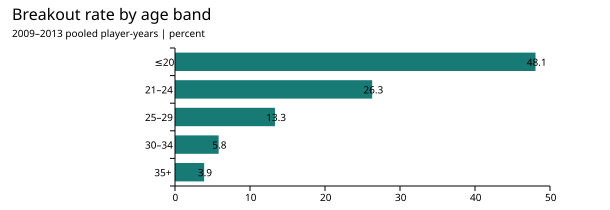
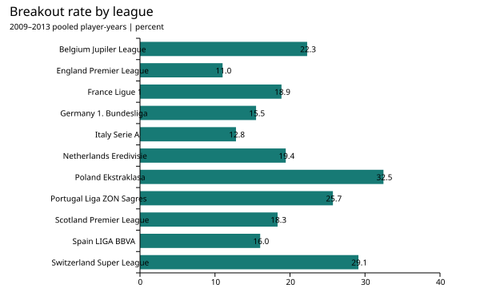

# First check-in · Predicting breakout football players

In 2011, a scout could follow 361 of the 3,618 eligible players. Choosing the largest gaps between FIFA potential and overall rating found 160 of the 729 eventual breakouts. Randomly choosing the same number would find about 73 on average. The gap ranking also beat random selection in 2012 and 2013.

## What one cleaned row means

On August 1, 2011, Mark Davies had started nine matches in the preceding league season. His latest overall rating was 72 and his potential was 78, giving him a six-point gap. His next observed annual rating was 75. The median change among eligible players that year was zero, so his three-point increase qualified as a breakout. The scout knew the first three numbers on August 1. The later rating and median are used to grade the prediction.

Open the [20-row cleaned sample](checkin/cleaned_preview.csv) or the [full compressed CSV](checkin/cleaned_player_years.csv.gz). Each row has a player ID, prediction year, dated rating snapshots, predictors, outcome and split.

## How the Python file builds the data

1. **Read ratings.** `load_ratings` checks numeric rating fields against the 0–100 range and removes 836 of 183,978 rows with missing overall rating. Among the remaining records, zero player/date pairs are duplicates. Player API IDs connect the ratings, player details and match lineups.
2. **Reconstruct starts.** `match_features` turns the 11 home and 11 away lineup slots into rows. It counts each identified player once per match. Only games from the preceding named season played before August 1 qualify. Missing lineup IDs mean some actual starts cannot be counted.
3. **Describe the player's season.** Total starts include every club. For a transfer, the primary club is the club with the most starts, breaking ties by lower team ID. Start share divides primary-club starts by that club's matches. Club points per game uses three points for a win and one for a draw. Position is the most frequent available pitch-depth band (1 goalkeeper, 2–5 defender, 6–8 midfielder, 9–11 forward). This is a formation-based approximation. Relative rating compares a player's current rating with the mean of the other rated starters assigned to that club, before filtering for follow-up.
4. **Pair the snapshots.** `build_cohorts` selects the latest nonmissing overall rating in each of two consecutive 12-month windows. A window includes its first day and excludes its end. A rating dated on prediction day therefore belongs to follow-up. A breakout requires a change at least three points above that year's all-age median. The youth analysis uses the same labels and applies age in days divided by 365.25 ≤ 24 on the prediction date. This reproduces the proposal's youth count. The age plot uses completed years.
5. **Explore and score.** `explore` uses only 2009–2013 for charts and pairwise Pearson correlations. `baselines` ranks players separately within each validation year and cohort. Both strategies have a budget of 10% rounded down. The EA ranking breaks tied gaps by lower player ID. Both baselines work directly on observed scores, so they require no fitting, scaling or one-hot encoding.

### Coverage and missingness

Across 2009–2015, 29,149 starter-years produced 25,503 paired observations for 8,903 players. Of the 28,811 with a current rating, 3,308 (11.48%) lack a following rating. Players who leave rating coverage can differ from those who remain, so the results apply to starters with observable follow-up. The young subset contains 7,551 player-years for 3,972 players.

The last source rating is July 7, 2016. The cleaned file flags the 3,871 rows for 2015 as incomplete. Its outcomes are provisional. The 2014 cohort supplies 3,629 rows for final testing. Neither year's outcomes enter the plots, correlations or baseline comparisons. [Annual coverage](checkin/coverage.csv)

## What the plots and correlations show

Among 2009–2013 player-years, 48.1% of players aged 20 or younger broke out, compared with 13.3% at ages 25–29. Starting ratings also mattered. Players rated 60–69 broke out in 24.8% of cases, compared with 10.6% for ratings of 70–79.

Known position groups had similar observed rates, between 16.9% and 18.3%. The 808 rows without a usable position had a higher rate (32.4%). League rates varied from 11.0% in England to 32.5% in Poland. These are pooled comparisons. Differences in age, initial rating and coverage may contribute. [Counts and rates for each group](checkin/breakout_rates.csv)

Potential gap correlated positively with breakout (Pearson r = 0.306). Initial overall rating (−0.345) and age (−0.292) correlated negatively. Club points per game had little marginal association (0.001). Two pairs of skills illustrate redundancy: marking and standing tackle (0.953), and goalkeeper handling and positioning (0.976). These associations motivate testing whether the skills add information beyond the gap. [Skill correlation matrix](checkin/skill_correlations.csv) · [Predictor correlations and nonmissing counts](checkin/feature_correlations.csv)

## Scouting baseline on validation years

Precision is the fraction of the watchlist that broke out. Recall is the fraction of all breakouts found. For example, the 2011 all-player watchlist had 44.3% precision (160/361) and 21.9% recall (160/729).

| Year | All players · EA precision | All players · random | Young players · EA precision | Young players · random |
|---|---:|---:|---:|---:|
| 2011 | 44.3% | 20.1% | 66.4% | 37.6% |
| 2012 | 43.3% | 18.2% | 50.5% | 32.1% |
| 2013 | 36.4% | 11.4% | 53.2% | 23.7% |

Random precision is the cohort's breakout prevalence, the exact expectation over random shortlists. The full table also gives watchlist size, hits, recall, and average precision (a stepwise summary of the precision–recall curve). The random row uses prevalence as the no-skill precision–recall reference. [Annual baseline results](checkin/baseline.csv)
